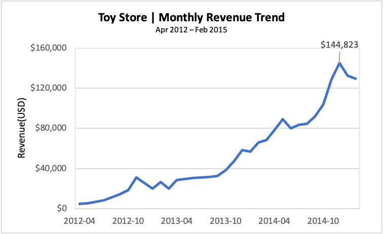
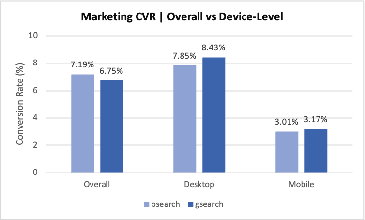
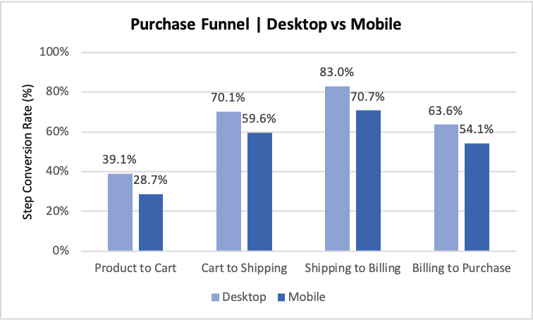
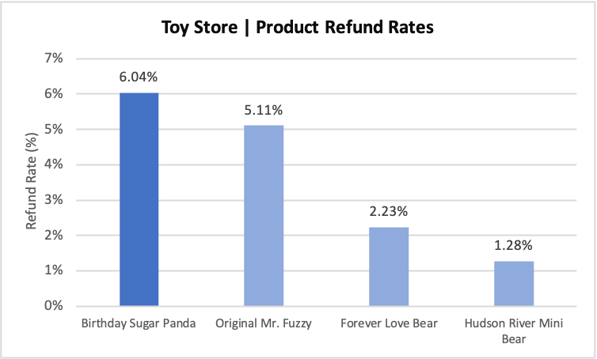

# Toy Store E-commerce Analysis | PostgreSQL SQL Portfolio 

## Project overview 

This project analyzes a toy-store e-commerce dataset to understand sales performance, marketing effectiveness, purchase-funnel conversion, and product-level profitability and refund rates. I used **PostgreSQL** and **pgAdmin 4** to import and validate six related tables, write SQL queries and interpreted the results.

**Goal:** Translate raw transactional and website behavior data into clear, actionable business insights. 

> **Dataset source:** [https://mavenanalytics.io/data-playground/toy-store-e-commerce-database]

> **Period covered:** March 2012-March 2015

## Business questions 

1. How have revenue, average order value, and gross profit evolved over time?
2. Which marketing channels and devices convert sessions into orders most effectively?
3. at which purchase-funnel stages to sessions drop, especially on mobile?
4. Which products drive revenue, gross profit, and refunds?

## Tools and SQL concepts 

**PostgreSQL · pgAdmin4 · SQL**

Concepts used: 'JOIN', 'LEFT JOIN', 'GROUP BY', common table expressions(CTEs), 'CASE WHEN', conditional aggregation, 'COUNT(DISTINCT ...)', 'DATE_TRUNC', 'COALESCE', and "NULLIF'.

## Dataset

Six tables: 

| Table | Main purpose | 
|---|---|
| 'products' | Product catalog | 
| 'website sessions' | Session details, devices and acqusition tags | 
| 'website_pageviews'| Page visits and timestamps |
| 'orders' | Orders, order-level revenue and costs |
| 'order_items' | Individual ordered product items |
| 'order_item_refunds' | Refunded items and refund amounts | 

## Data Visualizations

### 1. Monthly Revenue Growth

Monthly revenue increased substantially over the analysis period,
peaking at $144,823 in December 2014.

*Note: Partial months (March 2012 and March 2015)
are excluded from this visualization.*

### 2. Marketing Conversion Performance

Although bsearch had a higher overall conversion rate,
gsearch outperformed bsearch within both desktop and mobile
segments, illustrating Simpson's Paradox.

### 3. Desktop vs Mobile Purchase Funnel

Mobile sessions had lower conversion rates at every funnel stage.
The largest device-level gap occurred between Shipping and
Billing (12.29 percentage points).

### 4. Product Refund Rates

Birthday Sugar Panda had the highest refund rate (6.04%),
despite achieving the highest gross margin (68.49%).

## Key findings 

| Area | Finding | Why it matters | 
|---|---|---|
| Marketing | Overall session-to-order CVR: **8.50% desktop** vs **3.09% mobile** | Investigate device_level differences rather than only total traffic. | 
| Marketing | bsearch has a higher aggregate CVR than gsearch, but gsearch performs better **within both device categories** | Different device mixes can reverse aggregate comparisons (Simpson's paradox). |
| Funnel | Product-to-cart progression was **36.35%**, the lowest adjacent-stage conversion rate | Product browsing-to-cart progression is a sensible area for further investigation. | 
| Funnel | **Shipping --> Billing** had the largest desktop-mobile conversion gap(**12.29 percentage points**) | Examine this stage of the mobile experience; the underlying cause is not established. |
| Products | Original Mr. Fuzzy generated approximately **62.47% of product revenue** | Revenue is concentrated in one product. |
| Products | Birthday Sugar Panda had the **highest gross margin (68.49%)** and the **highest item refund rate (6.04%)** | Profitability and refund incidence should be evaluated together. | 

## Detailed Analysis

For additional findings, business implications, and
methodological limitations, see:

[Detailed Analysis Notes](analysis_notes.md)

## Detailed Analysis

For detailed findings, business implications,
and methodological limitations, see:

[View Detailed Analysis Notes](analysis_notes.md)

## SQL files 
| File | Contents | 
|---|---|
| '01_data_exploration.sql' | Data quality, cardinality and relationship checks | 
| '02_business_analysis.sql' | Monthly sales, AOV, profit and margins | 
| '03_marketing_conversion.sql' | Device and source conversion, channel revenue, missing UTM analysis | 
| '04_customer_funnel.sql' | Website page exploration and purchase-funnel analysis |
| '05_product_analysis.sql' | Product sales, gross profitability and refunds | 

> Rename the local SQL files to these filenames before uploading, or adjust the table above to match their actual names.

## Methodology and caveats 

- **Conversion rate:** Converted sessions / sessions in the specified cohort. The denominators differ between site-wide marketing CVR and product-page funnel conversion.
- **Funnel:** A strict first-visit-timestamp approximation using '/products', '/cart', '/shipping', '/billing' or '/billing-2', and '/thank-you-for-your-order'. It may not fully represent revisits or nonstandard paths.
- **Purchase proxy:** The funnel uses thank-you-page visits; agreement with the 'orders' table should be verified at the session level before treating this as a definitive count of purchases.
- **Missing traffic tags:** The literal string 'NULL' appears in some UTM/referrer fields and should not be confused with SQL 'NULL' or automatically labeled direct traffic.
- **Interpretation:** Findings describe correlations or observed differences, not established causal effects.

## Reproduce the analyses

1. Create a PostgreSQl database and import the six source tables with the appropriate columns and keys.
2. Check table counts, dates and relationships using '01_data_exploration.sql'.
3. Run the remaining '.sql' files in numerical order from pgAdmin's Query Tool.
4. Compare outputs to the findings in 'analysis_notes.md'.

**Note:** This repository does not yet contain the source CSV files or table-creation DDL. Add a permitted data source link and setup scripts to make the project fully reproducible. 

## Potential next steps

- Validate the funnel against the order table and handle complex revisit paths.
- Create a few visualizations(e.g., device-level funnel comparisons and product profitability vs refund rate).
- Compare trends after accounting for partial months and differing product launch dates. 
